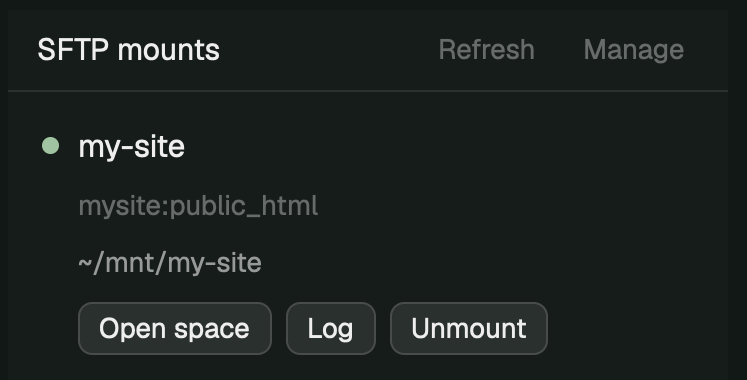

# SFTP mounts for Herdr

[Herdr](https://herdr.dev) mods for servers that only speak SFTP (shared hosting, managed WordPress, no shell): add them as [rclone](https://rclone.org) remotes, mount them as local folders, and let your agents edit them like any other folder. A side panel lists active mounts with Open space, Log and Unmount.

If your server gives you a real ssh shell, you don't need this: use Herdr's own machines (`hc machine add`) instead.

## Install

Ask your agent in Herdr to add `herdr.dev/mods/torchsmith/herdr-mod-sftp-mounts`, or copy `mods/sftp-mounts/` and `mods/sftp-panel/` into `~/.config/herdr-app/mods/` yourself. The panel docks on the right the first time Herdr sees it; open the manager from the command palette: **SFTP mounts**.

Needs `rclone` on your PATH (`brew install rclone`). Mounts use `rclone nfsmount`, so macOS needs no macFUSE and no sudo. Tested on macOS with rclone 1.74.

**Before installing:** these mods run programs: `rclone` (config, mount, test listings), `hc` (the mount runs in a herdr-core terminal), `mount`/`umount`, `mkdir`, `ssh-keyscan` and `ssh-keygen`. They read and write `~/.config/rclone/rclone.conf` through rclone, append to `~/.ssh/known_hosts` only when you click **Trust host key**, and put an `AGENTS.md` and a `CLAUDE.md` symlink in `~/mnt/` (beside the mounts, never inside one). rclone connects to the servers you add; the mods make no other network requests.

## Saving is deploying

Every save uploads the whole file to the live server within a second or two. There is no staging and no undo. The `AGENTS.md` placed in `~/mnt/` tells agents working in a mount exactly that, along with the rest of the rules (back up first, no scratch files in a web root, no `git init` or `npm install` in a mount, don't unmount). Claude Code picks it up automatically from any mount folder; edit `~/mnt/AGENTS.md` to change the rules.

Unmount from the panel or the manager, not with a plain `umount`: they stop rclone with ctrl+c so it finishes uploads first.

See [RECIPE.md](RECIPE.md) for the full description.

## License

MIT
