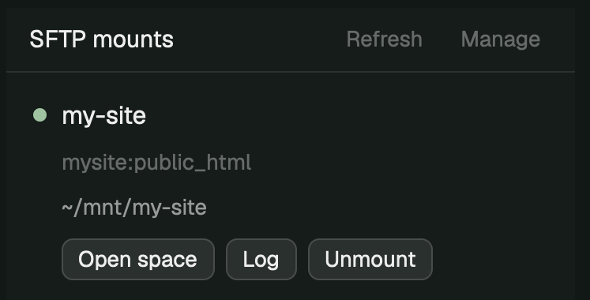

# SFTP mounts

Two mods for servers that only speak SFTP. **SFTP mounts** is a dialog that
adds, tests, mounts and removes rclone `sftp` remotes; each mount is a local
folder (`~/mnt/<remote>`) that agents edit like any other, and every save
uploads. **SFTP mounts panel** is a side panel listing the active mounts with
Open space, Log and Unmount.

## What you see

**The dialog** (`sftp-mounts`, a 640 px dialog, `popover` fill, 18 px padding):

1. Header: "SFTP mounts" (15 px semibold) and an **Esc** chip (11 px, `dim`)
   on the right. Below it a 12.8 px `muted` line: "Servers that only speak
   SFTP, mounted as folders so agents edit them like local files. Saves
   upload as soon as a file closes."
2. A list (scrolls past 380 px) with one row per rclone remote of type `sftp`,
   sorted by name. Each row (8 px radius, `hover` on hover): a 15 px server
   icon; the name (13 px) beside `user@host:port` and the remote folder
   (12 px `dim`); under it the mountpoint (11.5 px `dim`, prefixed `→ ` while
   not mounted); on the right the state: "Mounted" with a check (`ansi2`),
   "Not mounted" (`dim`), or a spinner (`working`) with "Mounting", "Finishing
   uploads", "Removing" or "Testing". A row of 26 px buttons: when mounted
   **Open space** (`solid`), **Log**, **Unmount**; otherwise **Mount**
   (`solid`), **Test**, **Remove** (turns into a red-bordered **Really
   remove?** on first click). Errors show under the row in 11.5 px `blocked`.
3. When a server's host key is unknown, a card under the row (`blocked` at
   ~8 % fill, ~25 % border, 8 px radius): a sentence asking to compare the
   fingerprint with what the host publishes, one chip per key
   (`ED25519  SHA256:…`, `background` fill), and **Trust host key and test**
   (`solid`) / **Don't trust**.
4. **Add server** (`solid`) and **rclone config…**. Add server swaps them for
   a form of 30 px inputs: name (170 px), user (130 px), host (flex), port
   (64 px); key file (flex), password (200 px, masked); remote folder (flex);
   an 11.5 px `dim` note about host keys and how passwords are stored; an
   error line; **Cancel** and **Add and test** (`solid`, "Adding…" while busy).
5. Without rclone: "rclone isn't installed…", `brew install rclone` and a
   **Run in a tab** button.

**The panel** (`sftp-panel`, docks right at 300 px, `surface` fill):

1. A 34 px header with a bottom border: "SFTP mounts" (12.5 px semibold) and
   two 11.5 px `dim` text buttons, **Refresh** and **Manage**.
2. One row per active mount (8 px radius, `hover` on hover): a 7 px dot
   (`ansi2` mounted, `blocked` when rclone runs but nothing is mounted), the
   remote name (13 px), "not from Herdr" (11 px `dim`) for strays; the rclone
   source (`remote:path`) and the mountpoint with `~` for home (11.5 px);
   22 px buttons **Open space**, **Log** (only for Herdr's mounts),
   **Unmount**, or a spinner with "Finishing uploads…" while unmounting.
3. Empty: "No active mounts." and a `solid` **Mount a server…** button.

## How it behaves

- **Remotes live in rclone** (`~/.config/rclone/rclone.conf`). The dialog
  lists `rclone config dump` entries with `type: "sftp"`. Add server runs
  `rclone config create <name> sftp host=… user=… port=… key_file=… pass=…
  known_hosts_file=~/.ssh/known_hosts --obscure --non-interactive` (only the
  fields filled), then Test. Names are 1-26 of `a-z 0-9 - _` (they become
  herdr-core terminal names). An empty key and password means ssh-agent. The
  remote folder is kept per remote in the mod's `localStorage`.
- **Test** runs `rclone lsf <remote>:<folder> --max-depth 1` (10 s connect
  timeout) and toasts the entry count, or shows the error's last lines.
- **Mount** creates `~/mnt/<remote>`, writes the agent notes (below), and
  starts `rclone nfsmount <remote>:<folder> <mountpoint> --vfs-cache-mode full
  --vfs-write-back 0s --dir-cache-time 10s --volname <remote>` in a background
  herdr-core terminal named `sftp-<remote>` (`hc run --bg --no-parent
  --no-notify`, label `sftp.remote=<remote>`). It waits up to 20 s for the
  mount to appear in `mount`; if it doesn't, it shows the terminal's last
  lines, kills and removes it.
- **Unmount** sends ctrl+c (`hc interrupt`): rclone finishes uploads,
  unmounts and exits. It waits up to 60 s, then falls back to `umount`; if
  the folder is busy it says so. The terminal is then removed.
- **Unknown host key:** an error containing `knownhosts: key is unknown`
  runs `ssh-keyscan` (with `-p` for a non-22 port) and `ssh-keygen -lf -`,
  and shows the card. Trust appends exactly the scanned lines to
  `~/.ssh/known_hosts` (creating `~/.ssh` as 700 only if missing) and
  re-tests. `knownhosts: key mismatch` shows a warning and never offers trust.
- **Remove** (second click) unmounts if needed and runs `rclone config
  delete`.
- **Open space** runs `space.new {name: "sftp: <remote>", folder}`; **Log**
  runs `terminal.peek` on `sftp-<remote>`; **rclone config…** opens
  `tab.new` with `rclone config`.
- **Agent notes:** on every mount, if missing, `AGENTS.mount.md` is copied to
  `AGENTS.md` in the mountpoint's parent (`~/mnt/`) and `CLAUDE.md` there is
  made a symlink to it. Existing files are never overwritten.
- **Refresh:** the dialog every 4 s while open; the panel every 5 s, only
  while its block is on screen (no hidden node above it, the chosen child of
  every stack) and the window is visible, plus on becoming visible.
- **The panel's list** is live `sftp-*` terminals from `hc ls --json`, each
  with its argv from `hc get` (source and mountpoint follow `nfsmount`),
  plus strays: `mount` entries of type nfs from `localhost:`/`127.0.0.1:`
  that no terminal owns.
- Agent status isn't shown: the mount terminals are not agents and carry no
  `herdr.space`/`herdr.tab` labels, so they stay out of tabs.

## Built from

- `mods/sftp-mounts/`: `main.js`; `mod.json` (`place: "none"`, a 640 px
  dialog overlay, a palette entry "SFTP mounts" running `mod.open`);
  `AGENTS.mount.md` (the notes for agents).
- `mods/sftp-panel/`: `main.js`; `mod.json` (`place: "right"`, `size: 300`);
  `sftp.svg` (a folder with a down arrow, stroke icon in `currentColor`, for
  a tab-bar button if you add one).
- Icons from Herdr's shipped `workspace-chrome`: `server.svg`,
  `circle-check.svg`, `spinner.svg`.
- `herdr`: `exec`, `hc`, `home`, `appHome`, `theme`, `props`, `closeOverlay`,
  `run` (`space.new`, `terminal.peek`, `tab.new`, `mod.open`), `notify`,
  `checking`, `layout`, `window`; `localStorage`.
- `gpui-base`: `v_flex`, `h_flex`, `InputState`/`Input` (`set_masked` for the
  password).
- Programs: `rclone`, `hc`, `mount`, `umount`, `mkdir`, `sleep`, `sh`,
  `ssh-keyscan`, `ssh-keygen`.

## Watch out

- **macOS:** use `rclone nfsmount`, not `rclone mount`: it needs neither
  macFUSE nor sudo.
- **A plain `umount` can lose data.** With rclone's default 5 s write-back,
  unmounting right after a write dropped the queued upload, and the pending
  copy left in rclone's VFS cache was replayed on the next mount. Keep
  `--vfs-write-back 0s` and stop rclone with ctrl+c (SIGINT/SIGTERM), which
  flushes before unmounting.
- macOS writes `._name` AppleDouble files for extended attributes; over this
  mount they are created and deleted again. `--exclude '._*'` does not stop
  them.
- **Host keys:** without `known_hosts_file`, rclone's sftp backend accepts any
  host key. Setting it means a new server fails with `knownhosts: key is
  unknown` until it's trusted; that's what the trust card is for.
- `rclone config create … pass=…` puts the password on a command line for a
  moment; `--obscure` stores it obscured, not encrypted. Prefer keys or
  ssh-agent.
- `hc ls --json` carries no labels; find the mounts by terminal name
  (`sftp-<remote>`), which is why remote names are limited to 26 characters.
- Claude Code skips `@`-imports from outside the project until approved (and
  a headless run can't approve), so `CLAUDE.md` must be a symlink or copy, not
  `@AGENTS.md`.
- `init()` runs during `herdr-app check`: return early on `checking()` before
  starting timers or running programs.
- Mounts don't come back after a reboot or a herdr-core restart (a lost kept
  terminal becomes a shell, and these aren't kept); press Mount again.

## Done when

- `herdr-app check` passes for both mod folders.
- With no rclone on PATH, the dialog shows the install line.
- Add server with a host, user and password creates an `sftp` remote in
  `rclone config dump`, and Test lists the remote folder.
- A server missing from `known_hosts` shows its fingerprints; Trust adds them
  and the re-test passes.
- Mount makes `~/mnt/<remote>` show the server's files; a file written there
  appears on the server within a few seconds; `~/mnt/AGENTS.md` and the
  `CLAUDE.md` symlink exist.
- The panel lists the mount; Unmount there removes it from `mount` with every
  write uploaded, and the `sftp-<remote>` terminal is gone.
- A Claude Code session started in the mount can say, without reading files,
  that saving uploads to the live server.
